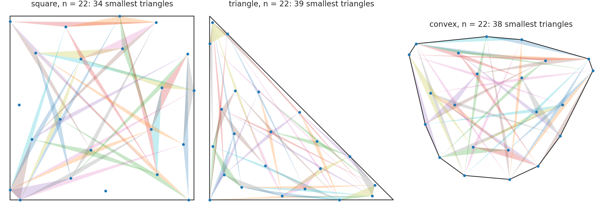

# heilbronn-pipeline



A search pipeline for the Heilbronn triangle problem: place `n` points so that the smallest triangle they form is as
large as possible. Three variants, as in the public record tables at <https://math.tejstead.com/heilbronn>:

| letter | region | value |
|---|---|---|
| `s` | unit square [0,1]² | min area |
| `t` | triangle (0,0), (1,0), (0,1) | min area / (1/2) |
| `c` | convex hull of the points (convex variant) | min area / hull area |

As of 27 November 2026 configurations found with this pipeline are the records in 221 of the 294 cells with n ≤ 100
(181 of the 192 cells with 37 ≤ n ≤ 100). The picture above shows three of them (n = 22, all smallest triangles shaded;
made with `docs/make_banner.py`).
The method is described in the accompanying paper (`paper/`); this repository is a compact version of the research code
that found the records.

## How it works

```
Generate ──> Refine (LP relocation, min-norm ascent) <──> Perturb (ruin & recreate) ──> Polish (SLP, tie system) ──> exact gate
    │                                                                                      ^
    └──> GPU screen: ~3·10⁴ neighbour seeds per cycle, soft-min L-BFGS in float32 ─────────┘
```

All components read their starting points from one table of best configurations (one file per cell, `data/best/`)
and offer their results to it, so every improvement immediately re-seeds the neighbouring cells (n ± 1, n ± 2, and the
other variants).

| component | where |
|---|---|
| containers, areas, values | `heilbronn/geometry.py` |
| trust-region SLP with lossless active-set reduction | `heilbronn/polish.py` |
| tie system in mpmath, 32-decimal truncation, exact value | `heilbronn/refine.py`, `heilbronn/exact.py` |
| seeds along n, deletion scan, GPU screening driver | `heilbronn/neighbours.py` |
| Metal kernels (greedy insertion, soft-min L-BFGS, convex hull term) | `heilbronn/gpu.py` |
| transfer between variants (affine maps) | `heilbronn/transfer.py` |
| table of best configurations | `heilbronn/store.py` |
| driver (GPU loop, deletion scans, transfers, C engine slots) | `heilbronn/run.py` |
| C engine: ruin & recreate, symmetric starts, LP relocation + min-norm ascent | `csrc/` (see `csrc/README.md`) |

## Install

Python 3.9 or newer. The GPU stage needs an Apple Silicon Mac (Metal through `torch.mps`); everything else runs anywhere.

```bash
python -m pip install -r requirements.txt
make -C csrc
```

## Use

```bash
python -m heilbronn run s t c --n 37-100 --store data/best      # the search driver (stop: touch data/best/STOP)
python -m heilbronn polish s in.txt out.txt                      # SLP polish of one configuration
python -m heilbronn scan t in.txt out.txt                        # deletion scan: best (n-1)-point configuration
python -m heilbronn transfer c s in.txt out.txt                  # map a convex configuration into the square, polish
python -m heilbronn export c in.txt out.txt                      # tie refinement + exact value of the written decimals
python -m heilbronn verify c out.txt                             # exact value of a coordinate file
csrc/heil s 48 --group D4 --time 600 --out s48                   # one engine run (cold, D4-symmetric)
```

`run` uses `--cpu` worker processes (default: all cores but one), of which `--engines` (default a third) run the C
engine. Progress and improvements are logged to `<store>/run.log`. Without a GPU the screening is replaced by greedy
grid insertion on the CPU. A configuration file holds one point `x y` per line; lines starting with `#` are comments.

`data/best/` is a snapshot (27 November 2026) of our best configuration in every cell we worked on. Records on the site
are given with 32 decimals; `export` produces such coordinates and the exact value that the site's verifier will compute
(seconds for most cells; up to about 15 minutes for convex configurations near n = 100).

## Tests

```bash
python -m pytest tests
```

## License

MIT, see `LICENSE`.
